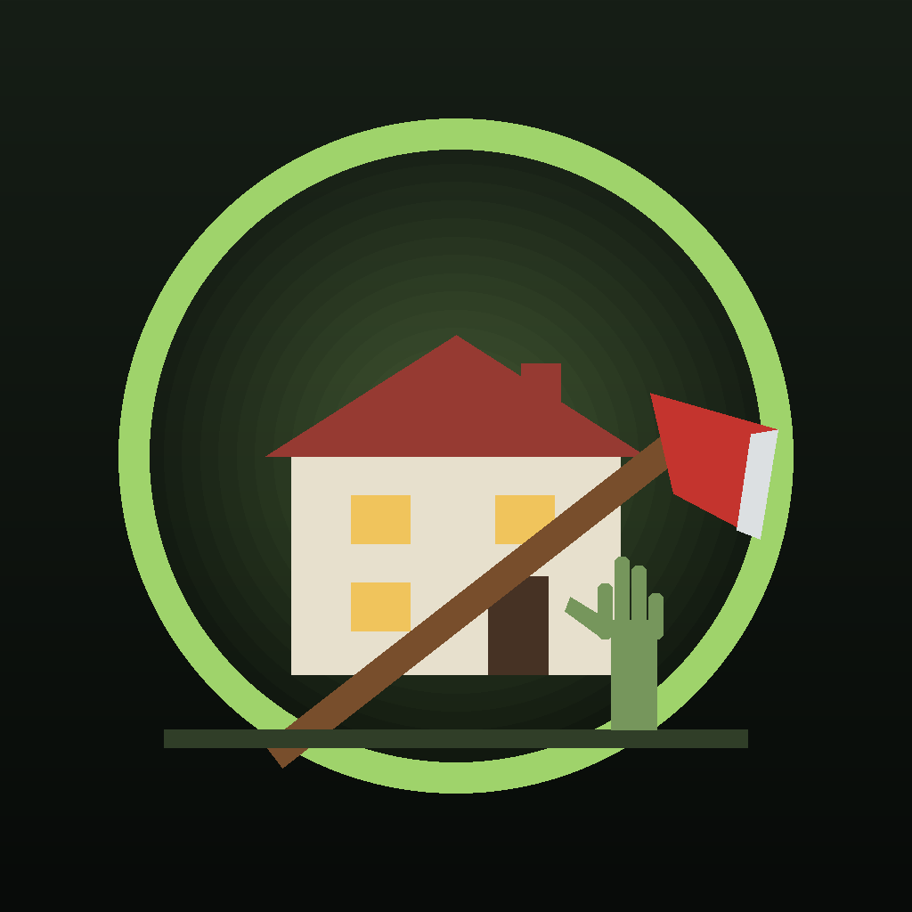
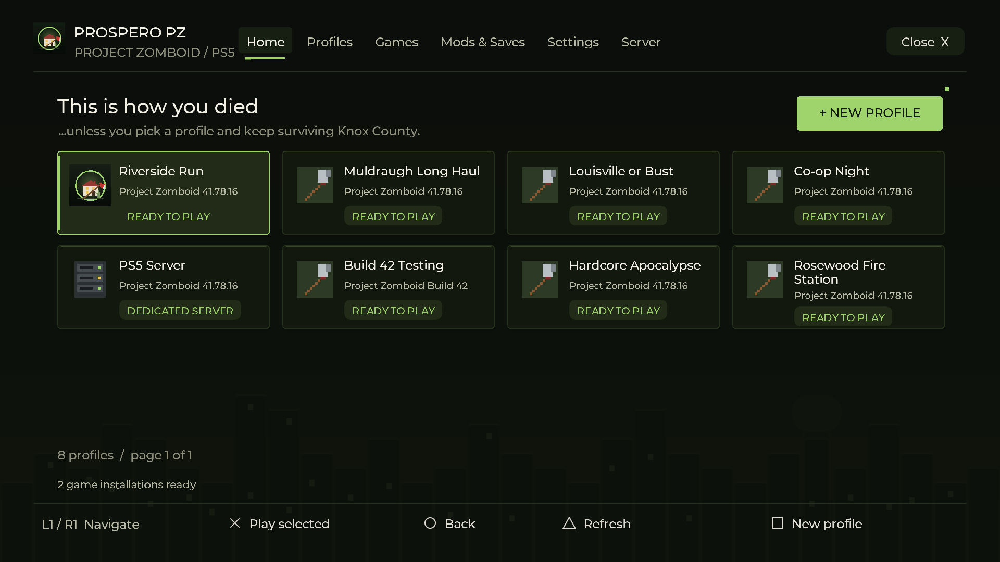

<p align="center">
  
</p>

<h1 align="center">ProsperoPZ</h1>

<p align="center"><strong>This is how you died... on your PS5.</strong><br>A Project Zomboid launcher and dedicated-server host for homebrew-enabled PlayStation 5.</p>

<p align="center">
  <a href="LICENSE"></a>
  
</p>

ProsperoPZ runs the Windows build of **Project Zomboid** on a homebrew-enabled PS5, with a native launcher made for the DualSense. Import your own copy of the game, keep separate profiles with their own worlds and mods, and host a **dedicated server** for friends on your network.

It is a fork of [ProsperoMC](https://github.com/Ayoubec/ProsperoMC) (Minecraft: Java Edition for PS5). Project Zomboid is also a Java + LWJGL + OpenGL game, so it runs on the same foundation: [prospero-win](https://github.com/mpereiraesaa/prospero-win) provides Wine, and OpenGL is translated to the PS5's Vulkan through Zink.



*Rendered by the launcher's own native UI code.*

> **Tested on a PS5 "Phat" (original model) on firmware 11.60** (Relapse + kstuff lite, ShadowMountPlus): Project Zomboid **Build 42 (42.21.0)** single player runs well, including Java mods through ZombieBuddy (e.g. Viewpoint). It is still experimental: back up worlds you care about. See [compatibility](docs/compatibility.md) for what is and is not verified.

## Features

- **Your game, imported in one step.** Copy your Windows Project Zomboid folder (Steam or GOG) over FTP or USB and choose **Import Game**. Uploads already on the PS5 are moved, not copied, so the import is instant. Build 41 and Build 42 can live side by side.
- **Profiles.** Each profile has its own `Zomboid` folder: worlds, mods, options and server settings never mix. Rename, duplicate or delete (deleted profiles move to `backups/`, they are not erased).
- **Mods.** Import Steam Workshop folders or mod `.zip` files as they are. Toggle mods from the controller; required mods are enabled automatically. Java mods work through [ZombieBuddy](https://github.com/zed-0xff/ZombieBuddy): put `ZombieBuddy.jar` in the game folder. Build 41 and Build 42 (`42/`, `common/`) mod layouts are both understood, and mod posters show in the list.
- **Saves.** Back up any world to a `.zip` with one button, restore worlds from your PC, and "delete" safely (worlds move to `backups/`).
- **Dedicated server.** A server profile runs Project Zomboid's headless server on the PS5 with a generated admin password, console-friendly defaults (pause when empty, autosave) and your enabled mods/maps written to its `.ini`.
- **Controller first.** Native gamepad mode uses Project Zomboid's own controller support (recommended). A mouse/keyboard emulation mode with Zomboid bindings and USB keyboard/mouse are also supported.
- **Tuned for PS5.** JVM settings are rewritten for Wine on PS5 (see [Performance](#performance)); resolution and fullscreen are written to the game's own `options.ini`.

## What you need

- A homebrew-enabled PS5 (tested: PS5 Phat, firmware 11.60, Relapse + kstuff lite) and a loader that supports folder-based applications, such as [ShadowMountPlus](https://github.com/drakmor/ShadowMountPlus).
- **Your own copy of Project Zomboid** (Windows version). ProsperoPZ never downloads or shares the game.
- A computer on the same network with FTP access to the PS5 (or a USB drive).

## Getting started

1. Build or download the package and copy `PPSA99777` to `/data/homebrew/PPSA99777` and the `prosperopz` data folder to `/data/ProsperoPZ` (see [Build and deploy](docs/build-and-deploy.md)).
2. Send your game to the PS5. The helper finds your Steam install automatically:
   ```bash
   python scripts/import-zomboid.py --ftp PS5_IP_ADDRESS --mods --saves
   ```
   Or copy the folder from *Steam → Project Zomboid → Manage → Browse local files* to `/data/ProsperoPZ/imports/` yourself, or to the top of a USB drive.
3. Open **ProsperoPZ → Games → Import Game**, pick the folder. A first profile is created for you.
4. Press **Cross** on the profile to play.

Steam is not running on the PS5, so the game always starts with `-nosteam`. Single player and non-Steam multiplayer work; Steam Workshop downloads and Steam friends/invites do not (copy mods instead).

## Hosting a server

Open **Server → Create Server Profile**, then **Start Server**. The screen shows the server name and admin password (user `admin`). Friends on your network start Project Zomboid **with `-nosteam`** (Steam: right-click → Properties → Launch options) and join the PS5's IP address on port **16261**. Mods enabled for the server profile are written to its `Server/NAME.ini` (`Mods=` and `Map=`); clients need the same mods.

The server saves every 10 minutes and when a logged-in admin runs `/quit`. Closing the app from the PS5 menu stops it immediately, so prefer `/quit`.

## Controls

| Input | Launcher action |
| --- | --- |
| D-pad / left stick | Move between items |
| Cross | Select / confirm |
| Circle | Back |
| Square | Contextual action (new profile, import, ...) |
| Triangle | Refresh |
| L1 / R1 | Switch tabs |
| Right stick / R2 | Move pointer / click |

In game, **Native gamepad** mode hands the DualSense to Project Zomboid as an Xbox-style controller and the game's own controller layout applies. The PS5 keeps the Create button for itself, so the **touchpad press** is the Xbox Back button (health/character panel). **Mouse / keyboard** mode maps: left stick/D-pad = WASD, right stick = mouse, R2 = attack (left click), L2 = aim (right click), Cross = interact (E), Circle = shove (Space), Square = reload (R), Triangle = map (M), L1/R1 = zoom, L3 = run (Shift), R3 = sneak (C), Options = menu (Esc), Create = Tab, touchpad = shout (Q).

## Performance

What ProsperoPZ changes compared with the game's own `ProjectZomboid64.json`:

| Setting | Why |
| --- | --- |
| ZGC/G1 replaced by Parallel GC, GC threads capped | ZGC needs multi-mapped memory that Wine on PS5 does not provide; Parallel GC commits fewer, larger regions and pauses briefly. |
| Compressed oops/class pointers off | The PS5 cannot reserve the low address range they require. |
| Heap from **Settings → Game memory** (default 4096 MB) | The game's 3 GB default is low for Build 42 and big modlists. |
| Larger code cache and metaspace | Avoids JIT-cache-triggered full collections during play. |
| `-Dzomboid.steam=0` and `-nosteam` | No Steam client on the console. |
| Absolute native library paths | The game's DLL folders resolve regardless of working directory. |
| Server: pause when empty, autosave every 10 minutes | Saves CPU and protects worlds on a console host. |

Lower in-game settings help most: lighting quality, 3D corpses/models, and fog. The resolution chosen in Settings is applied at launch; 1080p is a good default.

## Known limitations

- Console-tested on PS5 Phat consoles on firmware 11.60 and 13.60 with Build 42. Other firmwares, the PS5 Slim/Pro, Build 41, multiplayer and the dedicated server have not been tested yet. Please report results.
- Steam features (Workshop downloads, invites, achievements) are unavailable with `-nosteam`.
- The in-game **Host** button starts a second process, which the PS5 port cannot do; use a server profile instead.

## Help improve it

Report your firmware, loader, game build (41/42), mods and what happened. Send these logs from the run that went wrong (copy them over FTP or with a file manager such as PS5 Web UI Explorer):

- `/data/ProsperoPZ/logs/session-*.log` (newest numbers; one per launcher/game run)
- `/data/ProsperoPZ/instances/PROFILE/Zomboid/console.txt`

## Credits and license

Built on [ProsperoMC](https://github.com/Ayoubec/ProsperoMC) by Ayoubec, [prospero-win](https://github.com/mpereiraesaa/prospero-win), and the [PS5 Payload SDK](https://github.com/ps5-payload-dev/sdk).

ProsperoPZ application code is **GPL-3.0-or-later**. Dependencies keep their own licenses; see [Licensing](LICENSES.md) and [Third-party notices](THIRD_PARTY_NOTICES.md). Project Zomboid is not included and must be owned by the user.

This is an independent homebrew project, unaffiliated with The Indie Stone, Mojang, Microsoft or Sony.
